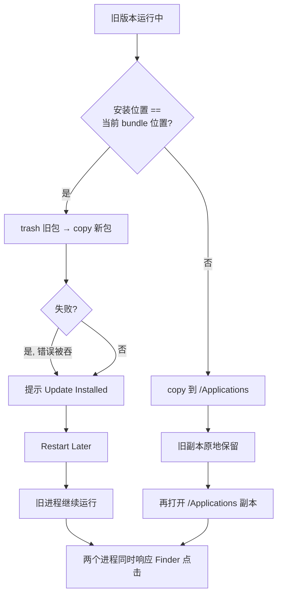

# 应用更新与安装（#179）

更新安装的职责边界：把新版本放到 `/Applications`、把旧副本清掉、保证同时只有一个
RClick 进程在响应 Finder 扩展的点击。

## 症状

更新完成后旧版本仍在，两个版本可以同时打开（#179 的截图里 2.3.3 和 2.3.0 各开着一个
设置窗口）。

## 根因

| # | 位置 | 问题 |
|---|---|---|
| 1 | `Updater.swift` `installApplication` | `trashItem` + `copyItem` 包在 `do/catch` 里，`catch` 只打印不抛出；`downloadAndInstallUpdate` 随后照常弹出「Update Installed」 |
| 2 | `Updater.swift` 授权判断 | 用 `isWritableFile(atPath:)` 判断能否写 `/Applications`。它只看 POSIX 权限，看不到沙盒拒绝，因此可能跳过 NSOpenPanel 授权，随后的写入被沙盒拒绝 |
| 3 | `Updater.swift` 安装目标 | 目标固定为 `/Applications/<app>`，与正在运行的副本位置无关。从下载目录、DMG 或改名的副本启动时，更新只会新增一份，旧副本留在原地 |
| 4 | 全局 | 没有单实例保护。两个副本都能启动，并且都注册 `DistributedNotificationCenter`，同一个右键点击会被两个进程各处理一次 |
| 5 | `Updater.swift` `launchNewApplicationAndExit` | 无论新版本是否启动成功都 `NSApp.terminate` |

## 规则

1. **失败必须可见**：安装链路上的错误一路抛出，界面只在真正成功后提示完成。
2. **先暂存再换位**：新副本先复制成同目录下的隐藏暂存包，校验
   `CFBundleShortVersionString` 等于 release 版本，再移走旧包、`moveItem` 换位。
   任何一步失败都不会留下「/Applications 里没有 RClick」的空窗。
3. **授权失败后重试一次**：第一次写入失败（沙盒拒绝）时弹出 NSOpenPanel 请求
   `/Applications` 授权，然后重试。不再依赖 `isWritableFile` 做前置判断。
4. **清理旧副本**：安装成功后，如果正在运行的 bundle 不在安装目标位置（下载目录、
   DMG、改过名字的副本），把它移进废纸篓。沙盒不允许时只记录日志。
5. **单实例（落败者自我退出）**：沙盒应用不能终止其他进程——`NSRunningApplication
   .terminate()` / `forceTerminate()` 在 App Sandbox 里返回 `false`（Apple 文档明确
   说明）。所以收敛由落败者自己完成：每个实例启动时枚举同 bundle id 的进程，版本
   高者留下；版本相同时后启动的留下；启动时间相同按 PID 决胜。不该留下的实例直接
   `NSApp.terminate`。另一个副本可能在启动之后才出现，因此每 2 秒复查一次。
   检查必须在注册 DNC 处理器之前完成。
6. **更新后立即重启，不提供「稍后重启」**：已经发布的旧版本没有自我让位的逻辑，
   沙盒也不能替它退出。留一个「稍后重启」会让旧进程继续运行，之后打开新版本就
   是两个实例同时响应 Finder 点击。旧进程自己退出是唯一可靠的收尾方式。
7. **重启失败不退出**：新版本启动成功后才 `terminate`，失败时保留当前进程并提示
   用户手动启动。
8. **测试宿主跳过单实例收敛**：单元测试的宿主进程与 App 使用同一个 bundle id，
   但它不是用户打开的副本。

## 验证

- `xcodebuild build` / `xcodebuild test` / `scripts/check-localization.py`
- 单实例判定：`SingleInstanceGuardTests`（版本、启动时间、PID 三种决胜条件）
- 版本比较：`VersionTests`
- 手工验证：从 `/Applications` 更新后只保留一份；从 DMG 或下载目录运行时更新，
  旧副本进入废纸篓；新实例启动后 2 秒内，旧实例自行退出，设置窗口只剩一个。
