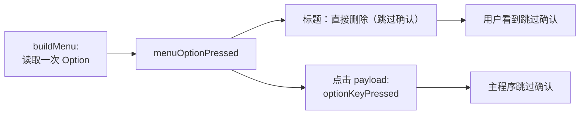

# Bug 记录：「直接删除」的 Option 状态判断与菜单提示不一致

| 项目 | 内容 |
|---|---|
| Issue | [#172](https://github.com/wflixu/RClick/issues/172) |
| 报告人 | [@Consciencieux](https://github.com/Consciencieux) |
| 状态 | **已修复，待手动验证**（未提交） |
| 引入提交 | `26263ea feat(actions): always confirm Direct Delete, hold Option to skip` |
| 影响版本 | 2.3.2（build 20261102001） |
| 涉及文件 | `FinderSyncExt/FinderSyncExt.swift`、`RClick/RClickApp.swift`、`CHANGELOG.md` |

## 现象

「直接删除」在菜单构建时按住 Option，标题会显示「直接删除（跳过确认）」。问题在于**实际行为没有跟着菜单标题走**：标题没有标记「跳过确认」时，点击仍然可能跳过确认。

| # | 操作 | 菜单标题 | 当前行为 | 新方案行为 |
|---|---|---|---|---|
| 1 | 按住 Option 右键，保持按住并点击删除 | 直接删除（跳过确认） | 跳过确认 ✅ | 跳过确认 |
| 2 | 按住 Option 右键，松开后再点击删除 | 直接删除（跳过确认） | 跳过确认 | 跳过确认 |
| 3 | 正常右键，点击时按住 Option | 直接删除 | **跳过确认 ❌** | 弹出确认 |
| 4 | 正常右键，按下并松开 Option，1 秒内点击 | 直接删除 | **跳过确认 ❌** | 弹出确认 |

情况 1、2 的标题已经明确写了「跳过确认」，用户点击的就是这个已标记的菜单项，行为与提示一致，视为正常。

真正要修的是情况 3、4：**菜单标题没有标记跳过，用户并不知道 Option 会生效，文件却被直接永久删除。**

> 情况 2 在原始 bug 报告中被视为危险，但本方案明确接受它：菜单上写的就是「（跳过确认）」，用户看到什么就会发生什么。与其去猜点击瞬间的按键状态，不如让标题成为唯一契约。

## 根因

为了绕开 Finder 异步点击回调的延迟，实现中使用了三路状态并取并集：

| 状态来源 | 代码位置 | 生命周期 |
|---|---|---|
| 菜单构建时的按键状态 | `buildMenu(for:)` → `menuOptionPressed = isOptionKeyPressed()` | **整个菜单会话内一直保留**，松开不清除 |
| 菜单打开期间的轮询 | `pollOptionKey()` → `optionSeenAt = Date()`，`optionRecentWindow = 1.0s` | 看到过一次按下后，1 秒内都算有效 |
| 点击回调时的按键状态 | `handleActionClick` → `resolvedOptionState()` | 只反映回调执行瞬间 |

```swift
private func resolvedOptionState() -> Bool {
    if isOptionKeyPressed() { return true }
    if menuOptionPressed { return true }
    if let seen = optionSeenAt, Date().timeIntervalSince(seen) <= Self.optionRecentWindow {
        return true
    }
    return false
}
```

任意一路为真即跳过确认：

- **情况 3**：点击瞬间检测到 Option → 跳过，但菜单标题没有标记，用户不知情。
- **情况 4**：`optionSeenAt` + 1 秒窗口把“曾经按下”延长成了“1 秒内都算按下”。

此外，主程序 `RClickApp.handleClickEvent` 还有一层实时兜底：

```swift
let liveOption = Self.isOptionKeyPressed()
let optionKeyPressed = (event.optionKeyPressed ?? false) || liveOption
```

它会再次引入“主程序处理消息时的状态”，与菜单标记进一步脱节。

### 为什么标题无法同步

Finder 在 `menu(for:)` 返回后会复制菜单项并由 Finder 进程显示。FinderSync 只保留有限属性（title、action、image、enabled、tag、state、indentationLevel、submenu），**不支持 `isAlternate`**，扩展也无法看到菜单展开期间的状态变化去更新已显示的副本。因此标题只能在菜单构建时确定。

这决定了一件事：**既然标题无法在点击前更新，行为就必须以构建时的标题标记为准，而不是以点击瞬间的按键状态为准。**

```mermaid
flowchart LR
    A[menu(for:) 构建菜单<br/>menuOptionPressed] --> T[菜单标题标记]
    A --> D{resolvedOptionState}
    B[100ms 轮询<br/>optionSeenAt + 1s 窗口] --> D
    C[点击回调<br/>isOptionKeyPressed] --> D
    D -->|任一为 true| E[payload optionKeyPressed = true]
    E --> F[主程序再 OR 一次 liveOption]
    F --> G[跳过确认并永久删除]

    T -.->|仅由 A 决定| G
    style T fill:#e8f4ff
```

标题只由 `menuOptionPressed` 决定，行为却由 A/B/C 的并集决定——这就是不一致的来源。

## 方案

### 核心规则：菜单标记即契约

**只要菜单构建时按住了 Option，标题显示「（跳过确认）」，本次点击就跳过确认；否则一律弹出确认框。**

标题和跳过行为由同一个变量 `menuOptionPressed` 驱动，二者不可能分叉：



### 改动内容

1. **`FinderSyncExt/FinderSyncExt.swift`**
   - `buildMenu(for:)`：保留 `menuOptionPressed = isOptionKeyPressed()`，每次构建菜单重新取值。
   - `makeActionItem`：保留现有标题标记逻辑，不改动。
   - `handleActionClick`：`optionKeyPressed` 直接使用 `menuOptionPressed`，不再调用 `resolvedOptionState()`。
   - 删除 `optionSeenAt`、`optionPollTimer`、`optionRecentWindow`、`pollOptionKey()`、`startOptionPolling()`、`stopOptionPolling()`、`resolvedOptionState()` 及各处 `stopOptionPolling()` 调用。
   - 保留 `isOptionKeyPressed()`（菜单构建时仍需读取）和 `optionKeySnapshot()`（诊断日志）。
2. **`RClick/RClickApp.swift`**
   - `handleClickEvent` 只使用 `event.optionKeyPressed ?? false`，删除 `liveOption` 兜底和 `isOptionKeyPressed()` 辅助方法。
   - 旧版扩展未携带该字段时按 `false` 处理 → 弹确认，是安全方向。
3. **`FinderSyncExt/Localizable.xcstrings`**
   - 保留 `%@ (skip confirmation)` key，不再删除。
4. **`RClick/Runtime/ActionService.swift`**
   - 不改动。`deleteFoldorFile` 仍以 `optionKeyPressed` 作为是否跳过确认的唯一依据。

### 影响范围

- 「复制路径」快链路在发送 payload 前已 return，不受影响。
- 其他动作不读取 `optionKeyPressed`，不受影响。
- 情况 2（标记后松开再点）仍跳过确认——这是菜单标记语义的直接结果，属于接受的行为。
- 情况 3、4（先开菜单后按 Option）不再跳过确认——修复目标。
- 不再存在轮询与 1 秒窗口，也没有点击时刻的时序竞态。

### 被否决的方案

| 方案 | 否决原因 |
|---|---|
| 点击瞬间检测按键（原方案一） | Finder 回调有延迟，必须叠加宽时间窗口；一旦以点击瞬间为准，标题又无法同步，仍然会出现“标题没写跳过却跳过”的不一致 |
| 取消 Option 快捷操作、恢复设置开关（原方案二） | 行为确定，但失去“临时跳过某一次”的快捷能力 |

## 实施清单

- [x] `FinderSyncExt/FinderSyncExt.swift`：删除轮询与三路状态，`handleActionClick` 改用 `menuOptionPressed`
- [x] `FinderSyncExt/FinderSyncExt.swift`：`makeActionItem` 标题标记保持不变
- [x] `RClick/RClickApp.swift`：移除 `liveOption` 兜底与 `isOptionKeyPressed()`
- [x] `FinderSyncExt/Localizable.xcstrings`：保留 `%@ (skip confirmation)` key
- [x] `CHANGELOG.md`：在 Fixed 中记录“菜单未标记「跳过确认」时不再跳过确认”
- [ ] 手工验证上表四种操作
- [x] `xcodebuild build` / `xcodebuild test` / `scripts/check-localization.py`

## 手工验证

| 步骤 | 预期 |
|---|---|
| 按住 Option 右键，保持按住点击「直接删除（跳过确认）」 | 不弹确认，直接删除 |
| 按住 Option 右键，松开后点击「直接删除（跳过确认）」 | 不弹确认，直接删除 |
| 正常右键，点击「直接删除」时按住 Option | **弹出确认框** |
| 正常右键，按一下 Option 再松开，1 秒内点击「直接删除」 | **弹出确认框** |
| 正常右键，直接点击「直接删除」 | 弹出确认框 |
| 选择多个文件重复上述操作 | 标题标记与确认行为一致，确认框条目数与实际删除数一致 |
