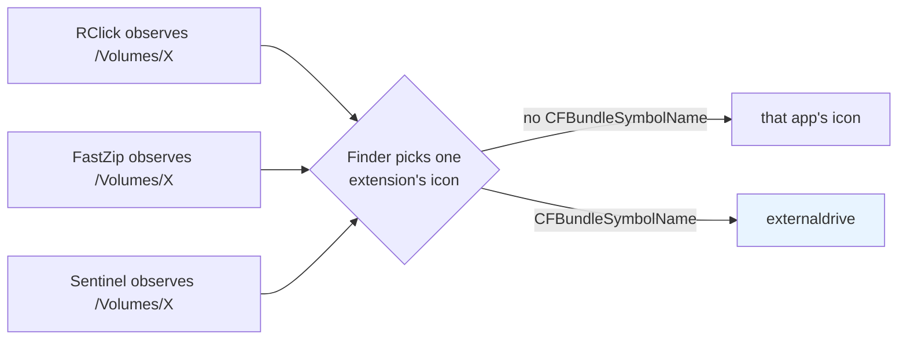

# External and network volume observation (#148, #150, #155, #158)

Finder observation and file-operation authorization are separate. Registering a
security-scoped bookmark in the app does not add a Finder Sync observation root.

## Observation roots

The extension registers `/` once at startup, then every mounted volume. Apple
documents recursive subdirectory observation but does not promise traversal
across volume boundaries, so `/` alone does not cover a volume mounted under
`/Volumes`. Enumerate with `FileManager.mountedVolumeURLs(includingResourceValues
ForKeys:options:[])`, without filtering out network, hidden, or non-removable
volumes. No directory traversal or volume resource-value queries are needed.

Subscribe to `NSWorkspace.shared.notificationCenter` before taking the initial
snapshot. Apply mount/unmount/rename notification URLs directly to the current
set. A real temporary HFS+ DMG probe demonstrated that, during didUnmount, volume
enumeration can still return the ejected volume. Blindly rescanning on every
notification therefore leaves stale roots. Re-enumerate only when notification
URLs are unavailable or the initial snapshot has not succeeded; preserve the
previous set on enumeration failure and apply event paths after any retry. Assign
`directoryURLs` only when the set changes. Observer lifetime follows the
extension; UI-framework interaction and observer cleanup use the main actor.

## The volume's sidebar icon (#155, #158)

Observing a root is also what makes Finder draw a sidebar icon for it. When the
observing extension declares no icon, Finder falls back to the containing app's
icon: every external disk and mounted disk image appeared in the sidebar wearing
RClick's icon. Measured on this machine against the installed 2.3.0: mounting a
DMG volume produced a sidebar entry carrying RClick's app icon, while `/`
(`Macintosh HD`) and every favourite folder kept theirs. Badges were blamed twice
for this symptom (#128, #155) and measured false both times; they are not
involved.

`CFBundleSymbolName` — nested under `CFBundleIcons > CFBundlePrimaryIcon` — is
the documented way to override that fallback. It is declared in the **containing
app's** `Info.plist` (the same key File Provider extensions use for their sidebar
icon) and only affects the Finder sidebar, not the Dock or the app icon. RClick
now declares `externaldrive`.

The key has to reach the bundle whose icon Finder would otherwise draw. The app
target generates its `Info.plist` (`GENERATE_INFOPLIST_FILE = YES`) and had no
`INFOPLIST_FILE`, so `RClick/Info.plist` was dead weight: the file-system
synchronized group copied it into `Contents/Resources/` and it never became
`Contents/Info.plist`. The target now sets `INFOPLIST_FILE = RClick/Info.plist`
— Xcode merges the generated keys into it, the same arrangement the extension
target already used — and excludes the file from the copy-resources membership.

### Several extensions compete for the same volume

Fixing RClick alone does not decide which icon a volume shows. Any Finder Sync
extension that registers the volume root is a candidate, and Finder does not
arbitrate between them: whichever one it picks paints *its* icon. Apps that do
not declare `CFBundleSymbolName` therefore reintroduce the problem even when
RClick is correct.

This was measured on the same machine, which had FastZip, Sentinel and RClick
enabled at once. With FastZip's extension enabled the USB volume showed FastZip's
icon; disabling it made the same volume show RClick's icon; both apps enumerate
mounted volumes and neither declared a symbol. Declaring `externaldrive` keeps
RClick out of the competition, but it cannot stop another extension from winning.

**Observing the volumes' contents instead of their roots does not work.** That
variant was implemented, and it removes the icon problem by never observing a
mount point — but it produced no menu anywhere on the volume, including inside
its folders. The reason is the sandbox: `application.sb` allows sandboxed apps to
read `(literal "/Volumes")` and nothing below it, and the extension holds no
bookmark for a user's volume, so its directory listing is denied and the volume
contributes no observation roots at all. A sandboxed FinderSync extension cannot
discover what is on a volume; it can only observe the volume.

So the extension keeps observing volume roots; only the icon they contribute is
now correct.

## Validation

- Release build and the complete existing test suite passed with
  `CODE_SIGNING_ALLOWED=NO` under Swift 6 and with signing enabled. Note that the
  test host must be signed: built with `CODE_SIGNING_ALLOWED=NO` it cannot open
  its App Group container, exits at launch, and the runner reports "hung before
  establishing connection" rather than a test failure.
- Regression test `notificationPathsOverrideStaleVolumeEnumeration` failed with
  rescan-only handling and passed after applying notification URLs.
- Tests cover startup volumes, simulated external/NAS/custom mount paths,
  mount/unmount/rename, duplicate events, failed enumeration and cleanup.
- A temporary DMG using the production observer and real NSWorkspace notifications
  produced `probe-volume-present=false → true → false` without restarting the
  observer. The DMG was ejected after the probe.
- The subdirectory variant was measured on this machine with a real USB volume
  (mounted at `/Volumes/UPAN`, folders at its root): the volume kept its own
  sidebar icon — the intended effect — and had no RClick menu anywhere, root or
  subfolder, which is why it was abandoned.
- Extension competition was measured on this machine with FastZip, Sentinel and
  RClick enabled together: the USB volume showed FastZip's icon, and disabling
  FastZip's extension made the same volume show RClick's icon. This is what
  identified the app icon as the winning extension's icon rather than an RClick
  mistake alone.
- The merged bundle plist was checked after a build: `Contents/Info.plist`
  contains `CFBundleSymbolName = externaldrive` alongside the generated keys
  (`CFBundleIconName`, `LSUIElement`, ...), and `Contents/Resources/Info.plist`
  no longer exists.
- Normal signing remains blocked by missing upstream provisioning profiles. This
  verifies observation-root management and bundle metadata, not a signed Finder
  installation or physical USB / SMB / NFS / AFP menu appearance and action
  execution.

After signing and enabling the extension, check a volume mounted before launch,
a USB drive and NAS mounted while running, a mounted DMG, rename/eject/remount,
and a normal local folder. Check menus inside each volume as well as on its root;
then verify an innocuous action such as Copy Path. File Provider-managed locations
and sandbox permissions are separate concerns; this change does not bypass them.

For the sidebar icon specifically, insert a USB volume and confirm the sidebar
entry shows a drive icon rather than RClick's app icon. Then re-enable FastZip's
Finder extension and insert the volume again: if FastZip's icon comes back, the
remaining conflict is Finder's missing arbitration, not RClick, and FastZip needs
the same `CFBundleSymbolName` declaration.

Sources:
- https://developer.apple.com/documentation/bundleresources/information-property-list/cfbundleicons/cfbundleprimaryicon/cfbundlesymbolname
- https://developer.apple.com/documentation/fileprovider/setting-the-finder-sidebar-icon
- https://github.com/sarensw/MacPacker/pull/346
- https://developer.apple.com/documentation/findersync/fifindersynccontroller/directoryurls
- https://developer.apple.com/documentation/foundation/filemanager/mountedvolumeurls(includingresourcevaluesforkeys:options:)
- https://developer.apple.com/documentation/appkit/nsworkspace/didmountnotification
- https://developer.apple.com/documentation/appkit/nsworkspace/didunmountnotification
- https://developer.apple.com/documentation/appkit/nsworkspace/didrenamevolumenotification
- https://developer.apple.com/library/archive/documentation/General/Conceptual/ExtensibilityPG/Finder.html
- `/System/Library/Sandbox/Profiles/application.sb` (`(literal "/Volumes")`)
